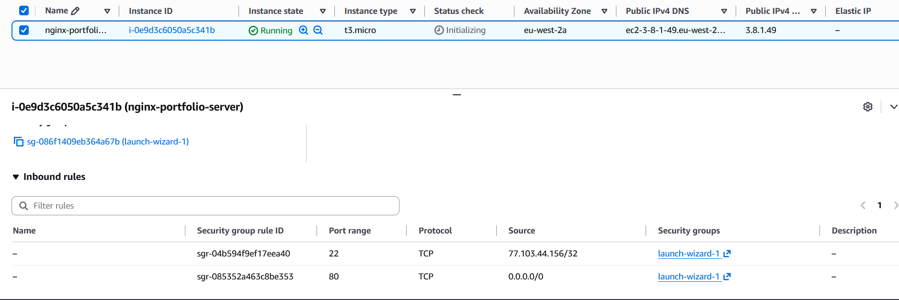
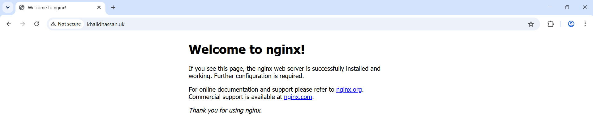
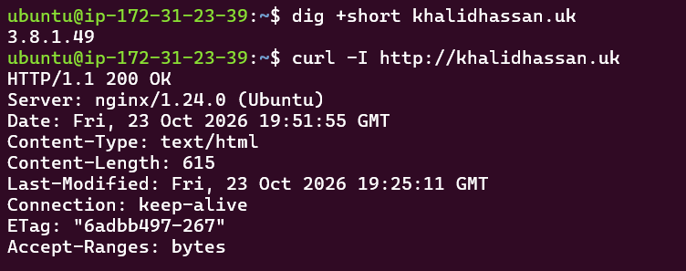

# Cloud Networking Capstone: Domain Routing, Security Groups & NGINX on AWS EC2

An end-to-end cloud networking implementation demonstrating DNS resolution, stateful firewall packet filtering, and reverse proxy/web server provisioning on AWS infrastructure.

---

## 1. Project Architecture

The deployment connects a custom top-level domain (`khalidhassan.uk`) to a live Ubuntu cloud instance via DNS A-record mapping, handling raw inbound HTTP traffic on port 80.

```text
+-----------------------------+
|    Client Web Browser       |
+--------------+--------------+
               |
               | 1. Resolves khalidhassan.uk
               v
+-----------------------------+
|    Cloudflare DNS Engine    |
| (Authoritative Nameservers) |
|   Record: A -> <EC2_PUB_IP> |
+--------------+--------------+
               |
               | 2. Returns IPv4
               v
+-----------------------------+
|  Internet Gateway / Route   |
+--------------+--------------+
               |
               | 3. TCP Handshake (SYN -> SYN-ACK -> ACK)
               v
+---------------------------------------------------+
|  AWS EC2 Security Group (Stateful Firewall)      |
|  - Port 22 (SSH)  : Restricted to Admin IP /32   |
|  - Port 80 (HTTP) : Ingress 0.0.0.0/0 (Internet) |
+----------------------+----------------------------+
                       |
                       | 4. Allowed Ingress
                       v
+---------------------------------------------------+
|       Ubuntu 24.04 LTS (t2.micro / t3.micro)      |
|                                                   |
|       +-----------------------------------+       |
|       |        NGINX Web Server           |       |
|       |        (systemd: active/running)  |       |
|       |        Listening on 0.0.0.0:80    |       |
|       +-----------------------------------+       |
+---------------------------------------------------+
```
## 2. Infrastructure & Network Specifications

| Parameter | Specification | Purpose |
| :--- | :--- | :--- |
| **Domain Registrar** | Cloudflare Registrar | Domain registration (`khalidhassan.uk`) |
| **DNS Management** | Cloudflare Authoritative DNS | Unproxied (Grey Cloud) `A` record routing |
| **Cloud Provider** | Amazon Web Services (AWS) | Virtual machine hosting (`eu-west-2` London) |
| **Instance Type** | `t3.micro` | AWS Free Tier compute resource |
| **Operating System** | Ubuntu Server 24.04 LTS | Debian-based Linux environment |
| **Web Server** | NGINX | HTTP daemon serving web root |
| **Firewall (SG)** | AWS Security Group | Layer 4 stateful ingress/egress filtering |

## 3. Step-by-Step Implementation

### Phase A: DNS Provisioning

1. Acquired top-level domain `khalidhassan.uk` via Cloudflare Registrar.
2. Created an apex `A` record pointing `@` (`khalidhassan.uk`) to `3.8.1.49`.
3. Disabled Cloudflare proxying (set to **DNS-Only / Grey Cloud**) to evaluate direct network transmission and avoid cached CDN proxy layers during evaluation.

### Phase B: AWS Security Group Configuration

Stateful rules configured for the instance virtual firewall:

* **SSH (Port 22):** Limited strictly to admin IP (`77.103.44.156/32`) to eliminate automated SSH brute-force attempts from public subnets.
* **HTTP (Port 80):** Ingress permitted from `0.0.0.0/0` (all IPv4 addresses) and `::/0` (IPv6) to accept global public web traffic.

### Phase C: Remote Access & Server Configuration

Exported the AWS RSA `.pem` private key into the local WSL/Ubuntu environment and enforced strict POSIX permission masks:

```bash
# Secure private key permissions (read-only by owner)
chmod 400 ~/.ssh/devops-ec2-key.pem

# Establish SSH tunnel to cloud instance
ssh -i ~/.ssh/devops-ec2-key.pem ubuntu@3.8.1.49
```

### Phase D: Web Server Lifecycle Management

Installed, initialized, and enabled the NGINX daemon under `systemd`:

```bash
# Update local package repository indices
sudo apt update

# Install NGINX web server
sudo apt install -y nginx

# Ensure persistent daemon startup on system reboots
sudo systemctl enable nginx
sudo systemctl start nginx

# Verify process status
systemctl status nginx
```

---

## 4. Network Diagnostics & Verification

### DNS Resolution Verification (`dig` & `nslookup`)

Validating that the authoritative nameservers accurately broadcast the A record globally:

```bash
dig +short khalidhassan.uk
# Output:
# 3.8.1.49
```

### HTTP Header Inspection (`curl`)

Probing the HTTP response status code and web daemon header over port 80:

```bash
curl -I [http://khalidhassan.uk](http://khalidhassan.uk)
```

---

## 5. Visual Proof

1. **AWS EC2 Console & Security Group Ingress Rules:**
   

2. **Cloudflare DNS Records:**
   

3. **Active NGINX Browser Landing:**
   

4. **Terminal Diagnostics:**
   

---

## 6. Challenges & Engineering Takeaways

* **Windows to WSL Key Management:** Transferring the `.pem` key from Windows host downloads (`/mnt/c/Users/...`) into WSL required setting exact POSIX permissions (`chmod 400`). Windows ACL-inherited permissions cause OpenSSH to reject keys due to `UNPROTECTED PRIVATE KEY FILE` alerts.

* **Cloudflare Proxy vs. Raw DNS Routing:** Setting Cloudflare proxy mode to "Proxied" masks the origin IP behind Cloudflare Anycast edge nodes. For debugging infrastructure and demonstrating bare-metal/EC2 routing in this assignment, switching to **DNS-Only (Grey Cloud)** allowed verification of direct TCP handshakes straight to AWS.

* **Dynamic vs. Elastic IPs:** Recognized that standard EC2 public IP addresses are dynamic and release on instance termination/stop. Production implementations require an AWS Elastic IP (EIP) or an Application Load Balancer (ALB) to avoid broken DNS records across maintenance cycles.
